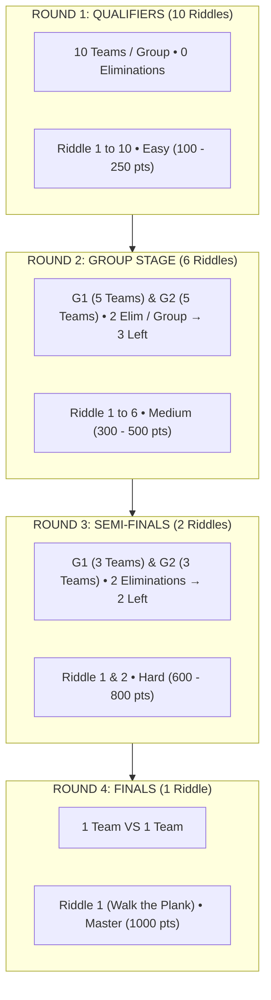

# Lost Code: 4-Round Tournament Structure & Interactive Locked Hint System Implementation Plan

> **For agentic workers:** REQUIRED SUB-SKILL: Use superpowers:executing-plans to implement this plan task-by-task. Steps use checkbox (`- [ ]`) syntax for tracking.

**Goal:** Re-architect the Lost Code CTF platform to adopt the 4-Round Tournament Flow from the tournament diagram (19 riddles: 10 in Round 1, 6 in Round 2, 2 in Round 3, 1 in Round 4), make the locked hint mechanism fully functional with an alert/confirmation popup and escalating score deductions (-5, -10, -15...), and apply `bg.png` as the global background.

**Architecture:**
- **Challenge Hierarchy & Storage (`private/flags.json`):** Restructure challenges into 4 sequential rounds matching the tournament flow: Round 1 Qualifiers (10 riddles), Round 2 Group Stage (6 riddles), Round 3 Semi-Finals (2 riddles), and Round 4 Finals (1 riddle). All 12 existing challenges and their salvaged file attachments are preserved and assigned to their respective rounds, and 7 new pirate riddles are added to complete the full 19-riddle roster.
- **Backend Protection (`server.js`):** `/api/challenges` serves round metadata (`round`, `roundName`, `riddleNumber`). Hints remain locked on the player dashboard until unlocked by the team (even for admin, allowing live preview and verification). Admin users bypass the `ctfStartTime` check so hint unlocks and flag tests work at any time.
- **Frontend Dashboard (`private/dashboard.html`):** Challenge filter tabs updated from simple difficulty pills to Round Tabs (`ROUND 1 (10)`, `ROUND 2 (6)`, `ROUND 3 (2)`, `ROUND 4 (1)`, `ALL`), plus a "📜 Tournament Flow" button that opens an interactive modal with the tournament flow diagram. Challenge cards display `ROUND X // RIDDLE Y` badges.
- **Locked Hint Alert & Deduction Flow:** When a locked challenge is viewed, the Quartermaster's Hint displays a locked card with cost. Clicking "Unlock Hint" triggers the warning alert/popup:
  `⚠️ Warning: X points will be deducted immediately from your crew's treasure! (Penalty escalates: -5, -10, -15...)`
  Upon confirmation, `/api/challenge/hint/unlock` deducts points, registers the unlock in `teams.json`, emits socket events, reveals the hint text, and notifies the user via alert/toast.
- **Visuals (`private/styles.css` & `public/styles.css`):** Connect `url("/bg.png")` with dark overlay.

**Tech Stack:** Node.js, Express.js, Socket.io, HTML5, CSS3 Tokens, Vanilla JavaScript.

---

## Tournament Flow Overview



---

## User Review Required

> [!IMPORTANT]
> **19 Riddles Distribution:**
> - **Round 1 (Qualifiers):** 10 Riddles (The Forged Manifest, Follow the Trail, Message in a Bottle, Dead Man's Switch, The Bovine Cipher, Sailor's Compass, Ghost Signal, The Quarterdeck, Smuggler's Cask, Kraken's Cipher).
> - **Round 2 (Group Stage):** 6 Riddles (The Governor's Vault, The Caribbean Log, Siren's Call, Cipher Chest, Port Royal Infiltration, Blackbeard's Logbook).
> - **Round 3 (Semi-Finals):** 2 Riddles (Sunken Registers, Ghost Mechanism).
> - **Round 4 (Finals):** 1 Riddle (Walk the Plank).
>
> All 12 existing challenges and zip attachments are preserved. The 7 new challenges have authentic pirate riddle lore, valid flag hashes, and hints.

> [!NOTE]
> **Locked Hint Experience:**
> Previously, logging in as `admin` caused `server.js` to return the plaintext hint immediately, skipping the locked card and alert modal. In this plan, challenge cards will display the locked state until unlocked by the team, allowing admins and players alike to trigger the warning alert popup and observe the escalating deduction (-5, -10, -15...).

---

## Proposed Changes

### Component 1: Data Model & Challenge Registry

#### [MODIFY] `private/flags.json`
- Reorganize keys to clearly reflect the round and riddle numbering:
  - `Round 1 - Riddle 1: The Forged Manifest`
  - `Round 1 - Riddle 2: Follow the Trail`
  - ... through `Round 1 - Riddle 10`
  - `Round 2 - Riddle 1: The Governor's Vault`
  - ... through `Round 2 - Riddle 6`
  - `Round 3 - Riddle 1: Sunken Registers`
  - `Round 3 - Riddle 2: Ghost Mechanism`
  - `Round 4 - Riddle 1: Walk the Plank`
- Each challenge object contains `round`, `roundName`, `riddleNumber`, `category`, `subtitle`, `points`, `difficulty`, `text`, `hint`, `resource`, `originalResourceName`, `hash`.

#### [MODIFY] `users.json` & `teams.json`
- Reset `solvedChallenges: []` for `user_admin_1`.
- Reset `hintsUnlocked: {}`, `solvedChallenges: {}`, and `score: 0` for `team_admin_1` so all 19 riddles are fresh and testable.

---

### Component 2: Backend API Enhancements

#### [MODIFY] `server.js`
1. **In `/api/challenges`:**
   - Include `round`, `roundName`, `riddleNumber`, `category`, and `hasHint`.
   - Send `hint` **only** when `isHintUnlocked` is true. For administrative challenge editing, provide a separate admin-only field `adminHint: isAdminUser ? flagsData[key].hint : null`.
   - Calculate `nextHintCost` as `((hintsUnlockedCount) + 1) * 5`.
2. **In `/api/challenge/hint/unlock`:**
   - Allow admin users to test unlock hints even if `ctfConfig.ctfStartTime` is not set.
   - Deduct escalating points: `cost = (currentCount + 1) * 5`.
   - Save timestamp and user to `team.hintsUnlocked[category]`.
   - Deduct score, update `scoreHistory`, emit `teamsUpdate` over Socket.io, and return:
     `{ message, hint, cost, teamScore, hintsUnlockedCount, nextHintCost }`.

---

### Component 3: Frontend Interface & Interactive Locked Hint Alert

#### [MODIFY] `private/dashboard.html`
1. **Navigation & Tournament Flow Banner:**
   - Add a "📜 Tournament Flow" button in the challenge panel header.
   - Clicking it opens `#tournamentFlowModal` displaying the diagram `/tournament_flow.png` and rules summary.
2. **Round Filter Tabs:**
   - Replace difficulty tabs with:
     - `ALL (19)`
     - `ROUND 1 (10)`
     - `ROUND 2 (6)`
     - `ROUND 3 (2)`
     - `ROUND 4 (1)`
3. **Challenge Cards:**
   - Display a pill badge: `ROUND X // RIDDLE Y`.
   - Display title, category, points, and solve counter.
4. **Locked Hint Card & Warning Alert:**
   - If `!chall.hintUnlocked`:
     Display the locked box with a lock icon, warning notice, and button:
     `<button class="hint-unlock-btn" onclick="openHintUnlockModal('${category}', ${cost})">`
     `  🔓 Unlock Hint (-${cost} PTS)`
     `</button>`
   - `openHintUnlockModal(category, cost)` opens `#hintConfirmModal`:
     - Displays title: `Quartermaster's Bargain`
     - Displays prompt: `Are you sure you want to reveal the Quartermaster's secret for "${category}"?`
     - Displays warning box:
       `⚠️ Warning: ${cost} points will be deducted immediately from your crew's treasure!`
       `Penalty increases with each hint unlocked: -5, -10, -15, -20 pts...`
     - Cancel button: `Keep Secrets` (closes without deduction).
     - Confirm button: `Deduct & Reveal` (disables button, calls API, reveals hint, shows toast alert, updates live score).
5. **Admin Portal Compatibility:**
   - Ensure the Admin Portal challenge editor uses `adminHint` so admins can still create, edit, and delete challenge hints seamlessly.

---

### Component 4: Background & Visual Polish

#### [MODIFY] `private/styles.css` & `public/styles.css`
- Change background image to `/bg.png` center / cover fixed with the existing dark contrast gradient.
- Add styles for Round badges, Tournament Flow modal, and warning alert styling.

---

## Verification Plan

### Automated / API Verification
1. Syntax validation:
   ```bash
   node -c /vault/Projects/Lost-Code/server.js
   ```
2. Server startup & static asset checks:
   - Verify `/bg.png` returns HTTP 200.
   - Verify `/tournament_flow.png` returns HTTP 200.
   - Verify `/api/challenges` returns all 19 riddles grouped into Rounds 1, 2, 3, and 4.
3. Hint unlock API verification:
   - Login as user/admin.
   - Call `POST /api/challenge/hint/unlock` on `Round 1 - Riddle 1: The Forged Manifest`.
   - Verify 5 points are deducted, `team.hintsUnlocked` is populated, and the plaintext hint is returned.
   - Call `POST /api/challenge/hint/unlock` on `Round 1 - Riddle 2: Follow the Trail`.
   - Verify 10 points are deducted, next cost is 15.
   - Call again on `Round 1 - Riddle 1: The Forged Manifest` and verify 0 points deducted (already unlocked).

### Manual Verification
1. Open the dashboard in browser.
2. Confirm the background displays `/bg.png`.
3. Check the Challenges tab:
   - Filter by "ROUND 1": displays 10 riddles.
   - Filter by "ROUND 2": displays 6 riddles.
   - Filter by "ROUND 3": displays 2 riddles.
   - Filter by "ROUND 4": displays 1 riddle.
   - Filter by "ALL": displays all 19 riddles.
4. Click "📜 Tournament Flow" button: verify the modal opens showing the tournament diagram and round rules.
5. Select a challenge:
   - Verify the Quartermaster's Hint shows the locked state with "Unlock Hint (-5 PTS)".
   - Click "Unlock Hint": verify the warning alert/modal pops up explaining the penalty and escalating cost.
   - Click "Keep Secrets": modal closes, no deduction occurs.
   - Click "Unlock Hint" again, then click "Deduct & Reveal":
     - Modal closes.
     - Notification toast appears.
     - Team score drops by 5 points.
     - Unlocked hint box appears showing the hint text.
     - Other challenge hint buttons update to "-10 PTS".
