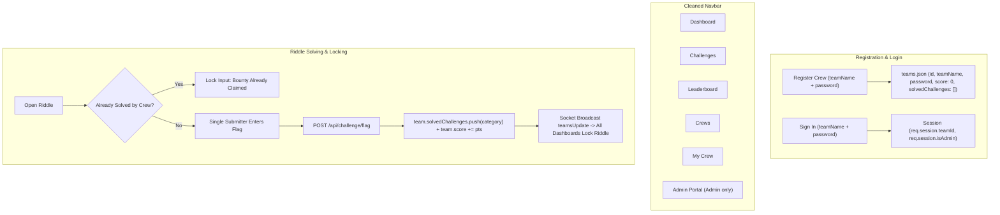

# Implementation Plan: Team-Only Architecture & Single-Submitter Flag Flow

> **For agentic workers:** REQUIRED SUB-SKILL: Use superpowers:executing-plans to implement this plan task-by-task. Steps use checkbox (`- [ ]`) syntax for tracking.

**Goal:** Completely eliminate the individual "Users" concept from the Lost Code tournament platform so that **Teams (Crews)** are the sole account, authentication, and scoring entity. Enforce that each team has a unified account where only one flag submission is accepted per riddle for the team, locking the riddle once claimed.

---

## User Review Required

> [!IMPORTANT]
> **Summary of Structural Changes:**
> 1. **Complete Removal of "Users" and "Profiles":**
>    - Remove **"Users"** (`#users-section`) and **"Profile"** (`#profile-section`) from navigation and UI.
>    - Remove the **"BUCCANEERS"** (user count) card from the dashboard overview stats, replacing it with a tournament-relevant metric: **"CLAIMED BOUNTIES"** (total team solves).
>    - Remove individual user search, pagination, and user profile editing.
> 2. **Streamlined Registration & Team Credential Flow:**
>    - Registration (`/public/index.html`) requires ONLY: **Crew Name**, **Password**, and **Confirm Password** (removes "Captain Alias").
>    - The registered team is the direct login account. No joining or creating separate teams post-login.
> 3. **Simplified "My Crew" Headquarters (`#team-section`):**
>    - Removes the legacy "Join Crew", "Create Crew", and "Leave Crew" actions.
>    - Transforms the section into a dedicated **Crew Headquarters** panel showing: Crew Name, Leaderboard Rank, Total Score, Solved Riddles Manifest, and Hints Unlocked.
> 4. **Team-Level Flag Submission & Locking:**
>    - In `server.js`, solved challenges are stored directly in `team.solvedChallenges: []`.
>    - When any member of the team submits a correct flag, it is credited to the team and immediately marked as solved for the team.
>    - In the Challenge modal, once a riddle is solved by the crew, the flag input and button are disabled and visually branded as `[ BOUNTY CLAIMED // SOLVED ]` with `Bounty already claimed by your crew!` so duplicate submissions are blocked both client-side and server-side.

---

## Architecture & Data Flow



---

## Proposed Changes

### Component 1: Landing Page & Registration (`public/index.html` & `public/app.js`)

#### [MODIFY] `public/index.html`
- In `#registerForm`:
  - Remove `<div class="input-field"><input type="text" id="registerCaptain" placeholder="Captain Alias (Optional)" /></div>`.
  - Form now strictly contains: `Crew / Team Name` (`#registerTeamName`), `Crew Password` (`#registerPassword`), and `Confirm Password` (`#registerConfirmPassword`).

#### [MODIFY] `public/app.js`
- In the register form submit listener:
  - Remove references to `registerCaptain`.
  - Submit `{ teamName, password }` directly to `/api/register`.

---

### Component 2: Dashboard UI Clean-up (`private/dashboard.html`)

#### [MODIFY] `private/dashboard.html`
- **Navbar:**
  - Remove `<a href="#" class="nav-link" onclick="showSection('users-section'); return false;">Users</a>`.
  - Remove `<a href="#" class="nav-link" onclick="showSection('profile-section'); return false;">Profile</a>`.
  - Cleaned nav links: `Dashboard`, `Challenges`, `Leaderboard`, `Crews`, `My Crew`, `Admin Portal` (if admin), `Logout`.
- **Hero Stats Row:**
  - Replace `#totalOperatorsCount` ("BUCCANEERS") card with `#totalSolvedCount` ("CLAIMED BOUNTIES").
- **Remove Sections:**
  - Remove `<section id="users-section">` entirely.
  - Remove `<section id="profile-section">` entirely.
- **My Crew Section (`#team-section`):**
  - Remove `#noTeamActions`, `#joinTeamSection`, and `#createTeamSection`.
  - Streamline `#myTeamInfo` to display the crew's name, total bounty, rank, list of solved riddles, and hints unlocked.
- **Challenge Modal Solved Locking:**
  - In `selectChallenge(category)`:
    - Check if `category` exists in `myTeamData.team.solvedChallenges`.
    - If solved:
      - Set `flagInput.value = 'Bounty already claimed by your crew!'`
      - Set `flagInput.disabled = true`
      - Set `submitFlagBtn.disabled = true`
      - Set `submitFlagBtn.textContent = 'SOLVED'`
      - Set `flagResult.textContent = '✓ Bounty Secured'`
    - If not solved:
      - Set `flagInput.disabled = false`, placeholder `lostcode{___________________________}`
      - Set `submitFlagBtn.disabled = false`, text `SUBMIT FLAG`
      - Clear `flagResult`
- **Script Cleanup:**
  - Remove `fetchUsers()`, `renderUsersList()`, and search handlers.
  - In `updateChallengeBoxesFromTeam()`: read solved list directly from `myTeamData.team.solvedChallenges`.
  - On init: remove `fetchUsers()` and remove `usersUpdate` socket listener.

---

### Component 3: Backend Routes & Team Data (`server.js` & `teams.json`)

#### [MODIFY] `server.js`
- **Session & Auth Helpers:**
  - Add helper `getCurrentTeam(req)` returning the active team from `req.session.teamId`.
  - Update `isAdmin(req, res, next)` to check if `req.session.isAdmin` or `req.session.teamId === 'team_admin_1'`.
- **`POST /api/register`:**
  - Accepts `{ teamName, password }`.
  - Validates uniqueness.
  - Creates team object in `teams.json`:
    ```javascript
    const newTeam = {
      id: 'team_' + Date.now(),
      teamName: teamName.trim(),
      password: bcrypt.hashSync(password, 10),
      score: 0,
      solvedChallenges: [],
      hintsUnlocked: {},
      scoreHistory: [{ timestamp: Date.now(), score: 0 }]
    };
    ```
- **`POST /api/login`:**
  - Validates team credentials against `teams.json`.
  - Sets `req.session.teamId = matchedTeam.id; req.session.teamName = matchedTeam.teamName; req.session.isAdmin = (matchedTeam.id === 'team_admin_1');`.
  - Sets `req.session.userId = matchedTeam.id;` for seamless backwards-compatibility.
- **`POST /api/challenge/flag`:**
  - Finds team via `req.session.teamId`.
  - Ensures `team.solvedChallenges` is an array: `if (!Array.isArray(team.solvedChallenges)) team.solvedChallenges = [];`.
  - Rejects if `team.solvedChallenges.includes(category)` with `400: 'This challenge has already been solved by your team.'`.
  - Validates bcrypt hash.
  - On solve: pushes `category` to `team.solvedChallenges`, adds `points`, appends to `team.scoreHistory`, writes `teams.json`, and broadcasts `io.emit('teamsUpdate')`.
- **`GET /api/myteam`:**
  - Returns `team` directly with `solvedChallenges: team.solvedChallenges || []`, `score`, `hintsUnlocked`, and leaderboard position.
- **`GET /api/teams`:**
  - Returns array of teams with `teamName`, `score`, `solvedCount: (t.solvedChallenges || []).length`.
- **Remove Obsolete Routes:**
  - Remove `GET /api/users`.
  - Remove `POST /api/users/username`.
  - Remove `POST /api/team/join` and `POST /api/team/leave` and `POST /api/team/create`.

#### [MODIFY] `teams.json`
- Ensure `team_admin_1` has `solvedChallenges: []`.

---

## Verification Plan

### Automated Checks
1. **Server Syntax:**
   ```bash
   node -c /vault/Projects/Lost-Code/server.js
   ```
2. **Team Registration & Login:**
   - Register new crew: `POST /api/register` with `{"teamName":"JollyRoger","password":"piratepassword"}`.
   - Login as crew: `POST /api/login` with `{"teamName":"JollyRoger","password":"piratepassword"}`.
   - Verify session receives `teamId`.
3. **Team Flag Submission & Solved Locking:**
   - Start CTF timer via admin.
   - Submit correct flag for `JollyRoger`.
   - Confirm points awarded and challenge added to `team.solvedChallenges`.
   - Re-submit the same flag: confirm HTTP 400 rejection `This challenge has already been solved by your team.`
4. **Dashboard Content Inspection:**
   - Fetch `/dashboard` with session cookies.
   - Confirm no "Users" or "Profile" in nav.
   - Confirm `#users-section` and `#profile-section` are gone.
   - Confirm `#myTeamInfo` displays crew data cleanly.

### Manual Verification
1. Open `http://localhost:3000` in browser.
2. Sign in as `lostcode` / `ahoy-captain`.
3. Verify clean navbar: `Dashboard`, `Challenges`, `Leaderboard`, `Crews`, `Admin Portal`, `My Crew`, `Logout`.
4. Open a challenge: verify clean layout.
5. Solve a challenge: confirm the challenge card turns green, and reopened modal shows `[ SOLVED ]` with disabled inputs.
