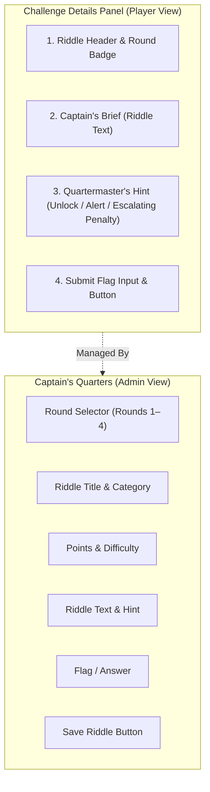

# Implementation Plan: Rules Popup Overhaul & Streamlined Challenge/Admin Interface

> **For agentic workers:** REQUIRED SUB-SKILL: Use superpowers:executing-plans to implement this plan task-by-task. Steps use checkbox (`- [ ]`) syntax for tracking.

**Goal:** Overhaul the login rules modal to reflect the **Lost Code Expedition & 4-Round Tournament Rules** (with `lostcode{...}` format and escalating hint costs), streamline the challenge details panel to display **only the Riddle, the Quartermaster's Hint, and the Flag Input** (removing all file attachment/download clutter), and update the Admin Portal accordingly with a dedicated Round selector and no file upload fields.

---

## User Review Required

> [!IMPORTANT]
> **1. New Rules Popup on Login (`#introModal`):**
> - **Branding:** Replaces all legacy `CoreDump 2.0` text with `LOST CODE // ARTICLES OF THE EXPEDITION`.
> - **Flag Format:** Updated to `lostcode{flag_name_here}` (lowercase, words separated by underscores).
> - **Tournament Structure:** Outlines the 4 rounds:
>   - **Round 1 (Qualifiers):** 10 Riddles • 0 Eliminations
>   - **Round 2 (Group Stage):** 6 Riddles • 2 Eliminations per group → 3 Teams Left
>   - **Round 3 (Semi-Finals):** 2 Riddles • 2 Eliminations → 2 Finalist Teams
>   - **Round 4 (Finals):** 1 Riddle • 1v1 Champion Showdown
> - **Hint System Rule:** Explicitly states the escalating penalty per crew (-5, -10, -15, -20 pts...).
> - **Tournament Flow Link:** Includes an embedded preview link to open the tournament flow diagram modal.

> [!NOTE]
> **2. Cleaned Challenge Details Panel:**
> - Removes the "SALVAGED FILES" (`#resourceContainer`) section entirely.
> - The challenge details panel strictly consists of:
>   1. **Riddle Header** (Title, Category, Round Badge, Points)
>   2. **Captain's Brief** (Riddle text)
>   3. **Quartermaster's Hint** (Locked with escalating deduction / Unlocked with revealed secret)
>   4. **Submit Flag** (Flag answer input + Submit button)

> [!NOTE]
> **3. Streamlined Admin Portal Challenge Configuration:**
> - Removes the file attachment uploader, drag-and-drop zone, file name display, and "remove attachment" checkbox.
> - Adds a dedicated **Round Selector** dropdown (`Round 1: Qualifiers`, `Round 2: Group Stage`, `Round 3: Semi-Finals`, `Round 4: Finals`).
> - Fields: Round, Riddle Title, Category Tag, Points, Difficulty, Riddle Question Text, Quartermaster's Hint, and Flag / Answer.

---

## Architecture & Visual Progression



---

## Proposed Changes

### Component 1: Login Rules Modal (`private/dashboard.html`)

#### [MODIFY] `private/dashboard.html`
- Overhaul `#introModal` markup:
  - Header: `LOST CODE // ARTICLES OF THE EXPEDITION`
  - Subtitle: `Welcome to the Lost Code Treasure Expedition. Read the articles and swear fealty to the tournament laws.`
  - Flag format box: `lostcode{secret_treasure_found_1337}`
  - Rules list:
    - 4 Tournament rounds with elimination quotas.
    - Quartermaster's escalating hint penalty (-5, -10, -15...).
    - Absolute ban on brute-forcing and infrastructure attacks.
    - Crew secrecy: no sharing flags across rival crews.
  - "View Full Tournament Flow Chart" button linking directly to `#tournamentFlowModal`.

---

### Component 2: Challenge Details Panel Streamlining (`private/dashboard.html`)

#### [MODIFY] `private/dashboard.html`
- Delete `#resourceContainer` and downloadable attachment markup from the right panel.
- In `selectChallenge(category)`, remove attachment handling (`chall.resource`, `dlBtn`, `attachmentName`).
- Ensure the right panel layout cleanly arranges:
  1. Header with `ROUND X // RIDDLE Y`
  2. Captain's Brief (`#challengeDescription`)
  3. Quartermaster's Hint (`#hintSection`)
  4. Submit Flag section (`#flagInput`, `#submitFlagBtn`)

---

### Component 3: Admin Portal Challenge Configuration (`private/dashboard.html` & `server.js`)

#### [MODIFY] `private/dashboard.html`
- In `#adminFormCard`:
  - Add `#adminRoundInput` dropdown:
    ```html
    <select id="adminRoundInput" class="admin-select">
      <option value="1">Round 1: Qualifiers (10 Riddles)</option>
      <option value="2">Round 2: Group Stage (6 Riddles)</option>
      <option value="3">Round 3: Semi-Finals (2 Riddles)</option>
      <option value="4">Round 4: Finals (1 Riddle)</option>
    </select>
    ```
  - Remove `#adminResourceInput`, `#fileNameDisplay`, and `#adminRemoveResource`.
- In `editChallenge(category)`:
  - Set `document.getElementById('adminRoundInput').value = currentChallenges[category].round || 1;`
  - Remove all references to `adminResourceInput` and `adminRemoveResource`.
- In `#adminFormCard` submit handler:
  - Submit `{ category, subtitle, round, difficulty, points, text, hint, flag }` without file upload headers.

#### [MODIFY] `server.js`
- In `POST /api/admin/challenges`:
  - Extract `round` from `req.body`.
  - Save `flagsData[category].round = parseInt(round) || 1`.
  - Save `flagsData[category].roundName = round === 1 ? 'Round 1: Qualifiers' : (round === 2 ? 'Round 2: Group Stage' : (round === 3 ? 'Round 3: Semi-Finals' : 'Round 4: Finals'))`.
  - Remove resource file handling logic.

---

## Verification Plan

### Automated Tests
1. **Server Syntax Check:**
   ```bash
   node -c /vault/Projects/Lost-Code/server.js
   ```
2. **Admin Challenge Update API Test:**
   - Log in as admin (`lostcode` / `ahoy-captain`).
   - Call `POST /api/admin/challenges` with updated text, round, and hint for a riddle.
   - Verify HTTP 200 and verify `/api/challenges` reflects the updated round, text, and hint.

### Manual Verification
1. **Login & Rules Popup:**
   - Log in at `http://localhost:3000`.
   - Verify the newly styled `#introModal` appears immediately.
   - Confirm it features `LOST CODE`, `lostcode{...}` format, 4 rounds overview, and escalating hint penalties.
   - Check the checkbox and click "Board the Ship" to enter dashboard.
2. **Challenge Page Inspection:**
   - Select any challenge.
   - Confirm there are NO downloadable file/attachment sections.
   - Verify only the Captain's Brief, Quartermaster's Hint, and Flag Input options are present.
3. **Admin Portal Challenge Configuration:**
   - Navigate to "Admin Portal".
   - Click to edit a challenge.
   - Confirm no file upload input exists.
   - Verify the Round selector is present and populated with the riddle's round.
   - Save changes and verify they update live on the dashboard.
