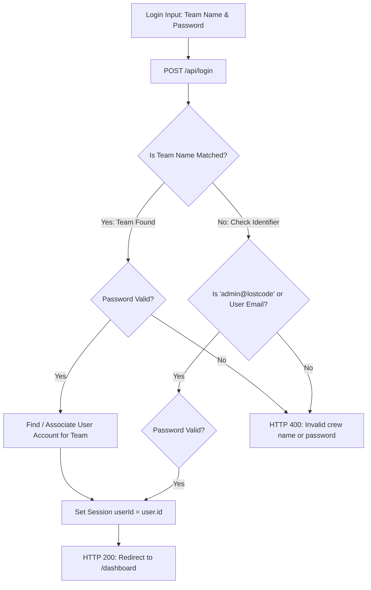

# Implementation Plan: Team/Crew Authentication & Admin Credentials Update

> **For agentic workers:** REQUIRED SUB-SKILL: Use superpowers:executing-plans to implement this plan task-by-task. Steps use checkbox (`- [ ]`) syntax for tracking.

**Goal:** Transform the authentication system of Lost Code from Individual Email + Password to **Team / Crew Name + Password**, update admin credentials to team `lostcode` (or `admin@lostcode`) with password `ahoy-captain`, and streamline the onboarding interface for pirate crews.

---

## User Review Required

> [!IMPORTANT]
> **New Login Credentials:**
> - **Admin Login:**
>   - **Team Name / Identifier:** `lostcode` (also accepts `admin@lostcode` or `admin`)
>   - **Password:** `ahoy-captain`
> - **Crew / Player Login:**
>   - **Team Name / Identifier:** Team Name (e.g. `BlackPearl`, `SeaWolves`)
>   - **Password:** Team Password

> [!NOTE]
> **Leaderboard & Solves Exclusions:**
> The admin team (`lostcode` / `team_admin_1`) is automatically excluded from public scoreboard rankings and solve counts so tournament organizers can test challenges without skewing metrics.

---

## Architecture & Data Flow



---

## Proposed Changes

### Component 1: Data Store Updates (`users.json` & `teams.json`)

#### [MODIFY] `users.json`
- Update admin user entry:
  - `username`: `"admin"`
  - `email`: `"admin@lostcode"`
  - `password`: Bcrypt hash of `ahoy-captain` (`$2b$10$A23zOSJuRgv81BCVBd83Z.D9d5z2MY1hH8ykTf5MfJNzEIzSuFviu`)
  - `teamId`: `"team_admin_1"`
  - `solvedChallenges`: `[]`

#### [MODIFY] `teams.json`
- Update admin team entry:
  - `teamName`: `"lostcode"`
  - `password`: Bcrypt hash of `ahoy-captain` (`$2b$10$A23zOSJuRgv81BCVBd83Z.D9d5z2MY1hH8ykTf5MfJNzEIzSuFviu`)
  - `members`: `["user_admin_1"]`
  - `membersNames`: `["admin"]`
  - `score`: `0`
  - `hintsUnlocked`: `{}`
  - `solvedChallenges`: `{}`
  - `scoreHistory`: `[{ "timestamp": 1787320792157, "score": 0 }]`

---

### Component 2: Backend Authentication API (`server.js`)

#### [MODIFY] `server.js`
1. **Helper `isAdminTeam(team)`:**
   - Centralize admin team detection: checks `team.id === 'team_admin_1'`, `team.teamName.toLowerCase() === 'lostcode'`, or name containing `'admin'`.
   - Update line 214 (`/api/challenges` solve counts) and line 399 (`/api/teams` leaderboard) to use `isAdminTeam(team)`.

2. **`/api/login` Endpoint:**
   - Accept `{ teamName, password }` (as well as `{ identifier, email, password }` for flexibility).
   - Match `teamName` case-insensitively against `teams`.
   - Handle admin aliases (`lostcode`, `admin@lostcode`, `admin`).
   - Validate password against team password (or associated user password).
   - Establish session `req.session.userId = user.id`.

3. **`/api/register` Endpoint:**
   - Support registering a new crew directly with `{ teamName, password, captainAlias }`.
   - Automatically creates the team in `teams.json` and captain in `users.json`, so newly registered crews can immediately log in with their Team Name and Password.

---

### Component 3: Frontend Login & Registration Interface (`public/index.html` & `public/app.js`)

#### [MODIFY] `public/index.html`
- Replace `#loginEmail` with `#loginTeam`:
  - `type="text"`
  - `placeholder="Crew / Team Name (e.g. lostcode)"`
- Update Sign In button and headers with pirate terminology.
- Update Sign Up form to "Enlist Crew" with fields:
  - Crew / Team Name
  - Captain Alias (Optional)
  - Password & Confirm Password

#### [MODIFY] `public/app.js`
- Update login submit handler:
  - Reads `loginTeam` and `loginPassword`.
  - Dispatches `POST /api/login` with `{ teamName, password }`.
- Update registration submit handler:
  - Reads team name and password.
  - Dispatches `POST /api/register`.
  - Auto-fills `#loginTeam` on success and switches to login view.

---

## Verification Plan

### Automated Tests
1. **Server Syntax Validation:**
   ```bash
   node -c /vault/Projects/Lost-Code/server.js
   ```
2. **Admin Authentication via Team Name:**
   - `POST /api/login` with `{"teamName":"lostcode", "password":"ahoy-captain"}` -> HTTP 200, session set.
   - Fetch `/api/profile` using session cookie -> confirms `isAdmin: true`, `teamName: "lostcode"`.
3. **Admin Authentication via Email Identifier:**
   - `POST /api/login` with `{"teamName":"admin@lostcode", "password":"ahoy-captain"}` -> HTTP 200, session set.
4. **Invalid Credentials Rejection:**
   - `POST /api/login` with `{"teamName":"lostcode", "password":"wrongpassword"}` -> HTTP 400.
   - `POST /api/login` with `{"teamName":"nonexistent", "password":"password"}` -> HTTP 400.
5. **New Crew Registration & Login:**
   - Register new crew `BlackPearl` with password `treasure123`.
   - Log in with `BlackPearl` / `treasure123` -> HTTP 200.
   - Fetch `/api/profile` -> confirms `teamName: "BlackPearl"`, `isAdmin: false`.

### Manual Verification
1. Open login page at `http://localhost:3000`.
2. Verify input placeholder reads `Crew / Team Name (e.g. lostcode)`.
3. Enter `lostcode` and `ahoy-captain`, click **Board the Ship**.
4. Verify redirection to `/dashboard` with full Admin Portal access and 0 score.
5. Log out, register a test crew, and verify seamless login with the new crew name and password.
