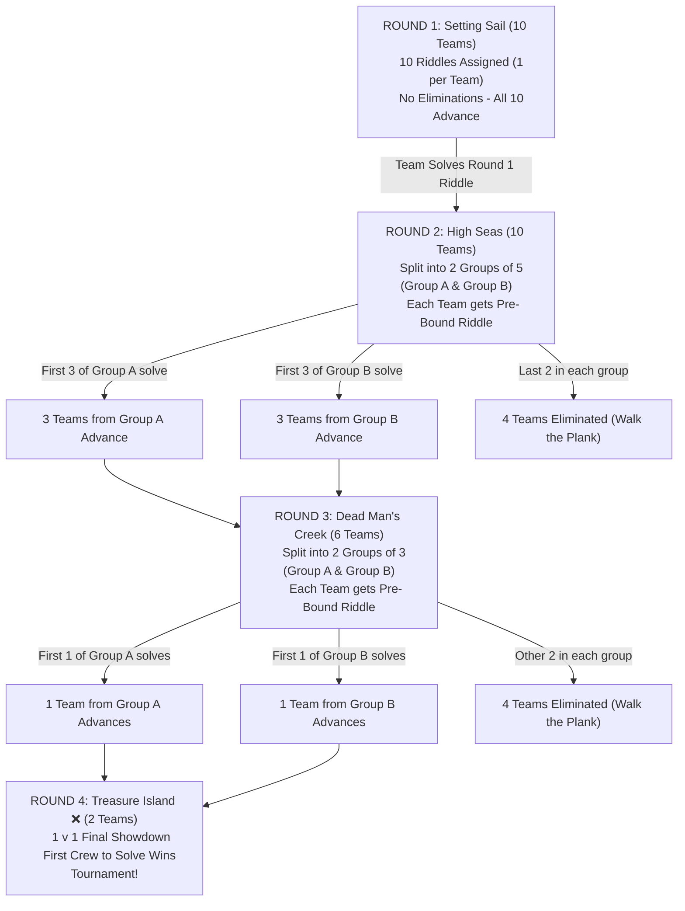

# Implementation Plan: 10-Team Tournament Riddle Allocation, Auto-Unlocking & Group Elimination

Architect and implement the complete tournament engine in [`/vault/Projects/Lost-Code`](file:///vault/Projects/Lost-Code):
1. **10 Teams & Pre-Bound Riddle Allocation:** Each team receives 1 allocated riddle per round.
2. **Automatic Round Unlocking:** Submitting the correct flag for a team's active riddle immediately unlocks the next round and loads their next pre-bound riddle.
3. **Group-Based Elimination Engine:**
   - **Round 1 (Setting Sail):** 10 teams $\rightarrow$ 10 riddles. All teams advance upon solving.
   - **Round 2 (High Seas):** 10 teams split into 2 groups (Group A: 5 teams, Group B: 5 teams). First 3 teams from each group advance (6 teams total). Remaining 2 teams per group are automatically eliminated (*Walked the Plank*).
   - **Round 3 (Dead Man's Creek):** 6 teams split into 2 groups of 3 teams. First 1 team from each group advances (2 teams total). Other teams are automatically eliminated.
   - **Round 4 (Treasure Island ❌):** 1 v 1 Final Showdown between the 2 remaining crews. First to solve wins the tournament bounty.
4. **Muted / Greyed-Out Visuals with SVG Padlock:**
   - Locked islands are greyed out / muted on the table map (`filter: grayscale(1) opacity(0.4) contrast(0.8)`).
   - **No lock emoji (`🔒`)** — replaced with a sleek antique SVG padlock badge and `LOCKED WATERS` label.

---

## Tournament Architecture & Flow



---

## User Review Required

> [!IMPORTANT]
> - **Pre-Bound Chained Riddles:**
>   - Teams will only be presented with **their currently assigned riddle** for the active round.
>   - When they enter the physical answer found in the field into the flag input, the system validates the answer and automatically unlocks the next round on the map with their next pre-bound riddle ready.
> - **Elimination Engine:**
>   - In Round 2, the 4th and 5th teams in Group A (and B) will be automatically marked as eliminated as soon as 3 teams in that group successfully submit their Round 2 flag.
>   - In Round 3, the 2nd and 3rd teams in Group A (and B) will be automatically marked as eliminated as soon as 1 team in that group successfully submits their Round 3 flag.
>   - Eliminated teams will see a dedicated pirate modal informing them that their crew has *Walked the Plank* and cannot submit further flags.
> - **Visuals (No Lock Emoji):**
>   - The raw unicode `🔒` emoji is completely eliminated from banners and island badges.
>   - Replaced by a custom styled SVG antique iron/brass padlock badge and muted typography.
>   - Locked islands on the table map are rendered in grayscale and muted opacity until unlocked by the team.

---

## Proposed Changes

### 1. Challenge Dataset (`private/flags.json`)

#### [MODIFY] [`private/flags.json`](file:///vault/Projects/Lost-Code/private/flags.json)
- Ensure Round 1 has exactly 10 distinct text riddles (restoring Riddles 1, 2, and 3: *The Forged Manifest*, *Follow the Trail*, *Message in a Bottle* as text riddles matching physical campus clue formats).
- Ensure Round 2 has 6 riddles, Round 3 has 2 riddles, and Round 4 has 1 riddle.

---

### 2. Backend Tournament Engine (`server.js`)

#### [MODIFY] [`server.js`](file:///vault/Projects/Lost-Code/server.js)

1. **Team Model Enhancement (`teams.json`):**
   - Track team progression attributes:
     - `currentRound` (1, 2, 3, or 4)
     - `unlockedRounds` (e.g. `[1]` initially, then `[1, 2]`, `[1, 2, 3]`, `[1, 2, 3, 4]`)
     - `allocatedRiddles`: `{ "1": "cat1", "2": "cat2", "3": "cat3", "4": "cat4" }`
     - `groupRound2`: `"A"` or `"B"` (assigned upon registration or admin seeding, 5 teams each)
     - `groupRound3`: `"A"` or `"B"` (assigned upon advancing from Round 2, 3 teams each)
     - `eliminated`: boolean
     - `eliminatedRound`: integer or null
     - `eliminatedReason`: pirate notice string

2. **Auto-Allocation on Registration (`/api/register`):**
   - Automatically assigns a unique Round 1 riddle from the 10 available riddles.
   - Assigns pre-bound riddles for Rounds 2, 3, and 4.
   - Assigns Group A or Group B (balancing 5 and 5).

3. **Flag Submission & Auto-Unlock Engine (`/api/challenge/flag`):**
   - Verify that the submitted challenge matches the team's `allocatedRiddles[currentRound]`.
   - Prevent submission if `team.eliminated === true`.
   - On correct flag verification:
     - Add challenge to `team.solvedChallenges` and award points.
     - **Round 1 Solve:**
       - Automatically advances crew: `team.currentRound = 2`, `team.unlockedRounds = [1, 2]`.
     - **Round 2 Solve:**
       - Check count of solves in `team.groupRound2`.
       - If team is within top 3 of their group:
         - Advances crew: `team.currentRound = 3`, `team.unlockedRounds = [1, 2, 3]`.
         - Assign `team.groupRound3` (Group A or B).
         - If this was the 3rd solve in the group: automatically mark the remaining 2 teams in this group as `eliminated = true, eliminatedRound = 2`.
       - Else:
         - Mark team as `eliminated = true, eliminatedRound = 2`.
     - **Round 3 Solve:**
       - Check count of solves in `team.groupRound3`.
       - If team is the 1st in their group:
         - Advances crew to 1v1 Final Showdown: `team.currentRound = 4`, `team.unlockedRounds = [1, 2, 3, 4]`.
         - Automatically mark the other 2 teams in this group as `eliminated = true, eliminatedRound = 3`.
       - Else:
         - Mark team as `eliminated = true, eliminatedRound = 3`.
     - **Round 4 Solve:**
       - Team wins tournament! Record tournament winner.
     - Persist `teams.json` and broadcast updates via Socket.IO (`teamsUpdate`, `roundAdvance`).

4. **Team-Specific API (`/api/my-team` and `/api/challenges`):**
   - Return team's `unlockedRounds`, `currentRound`, `allocatedRiddles`, and elimination status.
   - For players, `/api/challenges` filters to only their unlocked allocated challenges (admin continues to see all).

5. **Admin Tournament Seeding / Reset Tooling:**
   - Admin route `/api/admin/tournament/seed-teams` to auto-provision or reset the 10 pirate crews with their pre-bound riddle chains and Group A/B slots for rapid tournament setup.

---

### 3. Styling: Greyed-Out Islands & Antique SVG Padlock (`private/styles.css`)

#### [MODIFY] [`private/styles.css`](file:///vault/Projects/Lost-Code/private/styles.css)

1. **Muted / Greyed-Out Island Styling:**
   - Locked islands on the table map are rendered fully in grayscale with reduced contrast and opacity:
     ```css
     .map-island-station.is-locked {
       filter: grayscale(1) opacity(0.38) contrast(0.85);
       cursor: not-allowed;
     }

     .map-island-station.is-locked:hover {
       animation: none;
       filter: grayscale(0.9) opacity(0.5);
       transform: translate(-50%, -50%);
     }
     ```
2. **Elimination of Lock Emoji (`🔒`) & Antique SVG Padlock Styling:**
   - Replace any unicode lock emoji with SVG padlock badge:
     ```css
     .svg-padlock-badge {
       display: inline-flex;
       align-items: center;
       gap: 5px;
       color: #995555;
       font-family: 'Cinzel', serif;
       font-size: 0.72rem;
       font-weight: 700;
       letter-spacing: 0.08em;
     }
     .svg-padlock-icon {
       width: 13px;
       height: 13px;
       stroke: #a64444;
       fill: none;
       stroke-width: 2.2;
     }
     ```
3. **Elimination Banner / Overlay:**
   - Styling for eliminated crews with pirate-themed *Walked the Plank* modal.

---

### 4. Client Controller Logic (`private/dashboard.html`)

#### [MODIFY] [`private/dashboard.html`](file:///vault/Projects/Lost-Code/private/dashboard.html)

1. **Table Map Render (`renderRouteMap()`):**
   - Inspect team's `unlockedRounds` (retrieved from `/api/my-team`).
   - If round is unlocked:
     - Station is in full vivid color with hover bounce.
     - Banner shows round subtitle in parchment styling.
   - If round is locked:
     - Station gets `.is-locked` (greyed out).
     - Banner displays `<svg class="svg-padlock-icon">` + `LOCKED WATERS` (no lock emoji).
2. **Island Click Handler (`openRoundIsland(roundNum)`):**
   - If team is eliminated: display pirate *Walked the Plank* modal.
   - If round is locked for this team: show pirate alert (*"Arr! Your crew must solve your assigned riddle in Round [current] before setting sail for this island!"*).
   - If round is unlocked:
     - Open challenge window on opposite side (`dock-left` or `dock-right`).
     - Directly load the team's **allocated riddle** for that round!
     - Populate the riddle title, description, hint, and flag input.
3. **Flag Submission:**
   - On successful submit:
     - System displays *"Bounty Claimed! Advance to the next island!"*
     - Server automatically updates `unlockedRounds` and unlocks the next island.
     - The next island on the table map instantly springs to life with full color and animation!
4. **Admin Portal Tournament Monitor:**
   - Admin table displaying all 10 crews:
     - Crew Name, Group A / B, Round 1 solve status, Round 2 solve status & group rank, Round 3 solve status, Elimination status.
     - Controls to override or advance crews manually if necessary.

---

## Verification Plan

### Automated Tests
1. **Server Syntax & Startup:**
   ```bash
   node -c /vault/Projects/Lost-Code/server.js
   ```
2. **Tournament Simulation Script:**
   Create a test script `test_tournament_flow.js` that:
   - Registers 10 teams.
   - Verifies each team receives a distinct Round 1 riddle.
   - Solves Round 1 for Team 1 $\rightarrow$ verifies Round 2 unlocks automatically for Team 1 and Island 2 becomes active.
   - Solves Round 2 for 3 teams in Group A $\rightarrow$ verifies those 3 advance to Round 3, and the remaining 2 teams in Group A are automatically marked eliminated.
   - Solves Round 3 for 1 team in Group A $\rightarrow$ verifies Team advances to Round 4 (1v1 finale) and other teams in Group A are eliminated.

### Manual Verification
1. Login as a crew.
2. Verify Island 1 is in full color and active; Islands 2, 3, 4 are greyed out / muted with the antique SVG padlock (no emoji).
3. Click Island 1 $\rightarrow$ verify only the team's assigned riddle opens.
4. Submit the correct flag $\rightarrow$ verify Island 2 immediately blooms into full color, with auto-docking and Round 2 riddle ready to solve.
5. Verify admin sees all 10 teams in the Admiralty Tournament Monitor with live status and group brackets.
