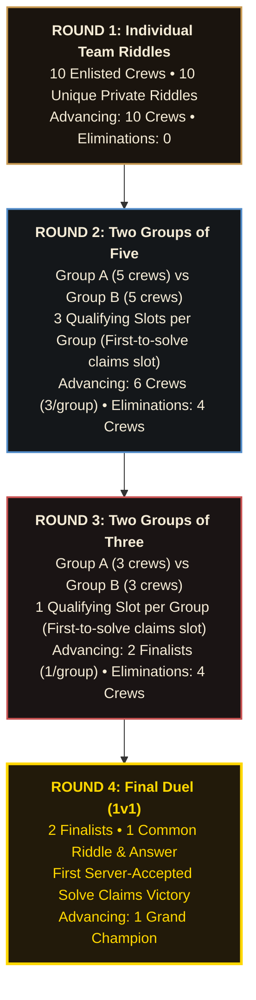

# LOST CODE — Multi-Round Tournament Implementation Plan

> **For agentic workers:** REQUIRED SUB-SKILL: Use superpowers:subagent-driven-development (recommended) or superpowers:executing-plans to implement this plan task-by-task. Steps use checkbox (`- [ ]`) syntax for tracking.

**Goal:** Implement the authoritative four-round tournament progression, deterministic riddle assignment model, strict server-side riddle privacy, and comprehensive admin suite (Round Management, Riddle Bank, Assignment Matrix, Pre-Launch Validation, and Audit Locking) for the Lost Code competition without altering the existing pirate theme and visual identity.

**Architecture:** A unified server-authoritative tournament engine in `server.js` powered by file-backed JSON stores in `private/` (`riddle_bank.json`, `tournament_assignments.json`, `round_state.json`, and `audit_log.json`). Participant endpoints (`GET /api/team/challenge` and `POST /api/team/submit`) enforce complete riddle privacy and atomic concurrency-safe slot claiming, while Socket.IO broadcasts sanitized round states to participants and real-time updates to the Admiralty Admin Portal in `private/dashboard.html`.

**Tech Stack:** Node.js, Express, Socket.IO, session-file-store, bcrypt, Vanilla JS (ES6+), CSS3 with brass/gold custom SVG antique aesthetics.

**Spec:** `/vault/Projects/Lost-Code/lost_code_round_flow.png` and user prompt specifications.

---

## Global Constraints

- **Preserve Visual Identity:** Maintain existing pirate theme, parchment surfaces, brass/gold borders, Cinzel/Pirata typography, table map with SVG routes, docking challenge window, scoreboard, and live counters.
- **Strictly Zero Lock Emojis:** Never use `🔒` or `🔓`; use antique SVG padlocks with brass keyholes.
- **Preserve Official 10 Teams:** Retain existing stable IDs (`crew_1_buccaneers` through `crew_10_searavens`) and exact team names from `teams.json`.
- **Riddle Privacy:** No client may ever receive another team's riddle, expected answers, flags, hints, or complete riddle banks over any endpoint.
- **No Dummy Riddles:** Do not create fake riddles or pre-solved challenges. All newly created riddles remain in `Draft` until explicitly configured and published by the administrator.
- **Server Authority & Concurrency:** Progression, slot claims, and championship victory are determined synchronously on the server before releasing the tick, preventing race conditions.

---

## Review Focus

1. **Simultaneous Submissions for the Same Slot:** Two teams submit valid answers for Round 2 Slot 1 within milliseconds of each other. The server must atomically accept the first, record the qualification, reject the second with a "Slot already claimed" message, and maintain exactly 1 winner for that slot.
2. **Unauthorized Cross-Team Challenge Snooping:** An authenticated team attempts `GET /api/team/challenge?teamId=crew_2_cutthroats` or alters session cookies. The endpoint strictly ignores query parameters, uses only `req.session.teamId`, and returns HTTP 403 if unauthenticated or not assigned.
3. **Pre-Launch Incomplete Assignment Guard:** Admin attempts to activate Round 2 when only 4 of 5 teams in Group A are assigned or when a slot lacks a published riddle. The pre-launch validator rejects activation with specific actionable errors.
4. **Eliminated Team Re-Entry Attempt:** A team eliminated in Round 2 attempts to call `POST /api/team/submit` in Round 3. The server immediately returns HTTP 403 Forbidden ("Your crew was marooned in Round 2 and cannot participate in this round").
5. **Admin Override Audit Trail:** An administrator alters an assignment in a `Live` round via the override modal. The system must verify admin privileges, require an override reason, apply the mutation, and write an immutable timestamped entry to `private/audit_log.json`.

---

## Tournament Progression Overview



---

## File Structure & Responsibilities

| File | Responsibility |
| :--- | :--- |
| `private/riddle_bank.json` [NEW] | Authoritative database of riddles (title, text, answer, matching rules, draft/published state, hints, points). |
| `private/tournament_assignments.json` [NEW] | Pre-configured round tournament blueprints: group rosters, slot definitions, and private team-to-slot assignments. |
| `private/round_state.json` [NEW] | Live round state: statuses (`Draft`, `Ready`, `Live`, `Completed`, `Locked`), claimed slots, round qualifiers, and eliminated crews. |
| `private/audit_log.json` [NEW] | Immutable administrative audit log recording all overrides, round activations, and state changes. |
| `server.js` [MODIFY] | Core Express server: schemas, concurrency-safe submission engine, private team endpoints, admin REST APIs, and Socket.IO real-time broadcasts. |
| `private/dashboard.html` [MODIFY] | Admiralty Admin Portal: Round Management Deck, Riddle Bank Suite, Team Assignment Matrix, Pre-Launch Validation Modal, and Participant Docking Window. |
| `private/styles.css` [MODIFY] | Styling for Round Cards, Riddle Bank modal/tables, Assignment Matrix, Validation badges, and antique SVG locks. |
| `tests/test_tournament_lifecycle.js` [NEW] | Automated end-to-end test suite executing all 13 testing requirements from the specification. |

---

## Detailed Task Breakdown

### Task 1: Persistent Tournament Schemas & Server Initialization

**Files:**
- Create: `private/riddle_bank.json`
- Create: `private/tournament_assignments.json`
- Create: `private/round_state.json`
- Create: `private/audit_log.json`
- Modify: `server.js:40-120`
- Test: `tests/test_tournament_schemas.js`

**Interfaces:**
- Consumes: `teams.json`, existing Express app.
- Produces: `getRiddleBank()`, `saveRiddleBank()`, `getTournamentAssignments()`, `saveTournamentAssignments()`, `getRoundState()`, `saveRoundState()`, `logAuditEvent()`.

- [ ] **Step 1: Write the failing test for schema loading and defaults**
  Create `tests/test_tournament_schemas.js` verifying that the server properly creates default tournament data files if absent, seeds the 4 tournament round templates, and exposes the helper functions.
- [ ] **Step 2: Run test to verify it fails**
  `node tests/test_tournament_schemas.js` -> FAIL (missing files and exports).
- [ ] **Step 3: Implement schemas and file management in `server.js`**
  - Initialize `private/riddle_bank.json` as an empty object `{}`.
  - Initialize `private/tournament_assignments.json` with 4-round blueprints:
    - Round 1: 10 slots (`R1_S1` to `R1_S10`), 10 teams.
    - Round 2: Group A (5 teams, slots `R2_GA_S1`, `R2_GA_S2`, `R2_GA_S3`), Group B (5 teams, slots `R2_GB_S1`, `R2_GB_S2`, `R2_GB_S3`).
    - Round 3: Group A (3 teams, slot `R3_GA_S1`), Group B (3 teams, slot `R3_GB_S1`).
    - Round 4: Final Duel (2 teams, slot `R4_FINAL_S1`).
  - Initialize `private/round_state.json` with initial statuses: Round 1 `Draft`, Rounds 2-4 `Locked`.
  - Initialize `private/audit_log.json` as `[]`.
  - Add thread-safe helpers in `server.js` with atomic writes (`fs.writeFileSync` to temporary file + rename).
- [ ] **Step 4: Run test to verify it passes**
  `node tests/test_tournament_schemas.js` -> PASS.
- [ ] **Step 5: Commit**
  `git add private/*.json server.js tests/test_tournament_schemas.js && git commit -m "feat(tournament): initialize tournament data schemas and persistence helpers"`

---

### Task 2: Strict Riddle Privacy & Private Participant Endpoints

**Files:**
- Modify: `server.js:400-600`
- Test: `tests/test_riddle_privacy.js`

**Interfaces:**
- Consumes: `req.session.teamId`, `tournament_assignments.json`, `riddle_bank.json`, `round_state.json`.
- Produces:
  - `GET /api/team/challenge` -> Returns `{ success: true, round: N, slotId, riddle: { id, title, text, hints, points }, roundStatus, isClaimed, isEliminated, isQualified }`.
  - `POST /api/team/submit` -> Authoritative submission endpoint with answer normalization and atomic slot claiming.

- [ ] **Step 1: Write the failing test for privacy enforcement**
  Create `tests/test_riddle_privacy.js` ensuring:
  - Team A only receives Team A's assigned riddle text.
  - Team A cannot pass `?teamId=crew_2` to inspect Team B's riddle.
  - Expected answers, flags, and other teams' assignment keys are never present in the response body.
  - Requesting challenge when round is not `Live` returns informative locked state without riddle text.
- [ ] **Step 2: Run test to verify it fails**
  `node tests/test_riddle_privacy.js` -> FAIL (endpoints not implemented).
- [ ] **Step 3: Implement `GET /api/team/challenge` in `server.js`**
  - Verify session authentication (`getCurrentTeam(req)`).
  - Determine team's active round and group.
  - Check `round_state.json` for current round status.
  - If round is `Live`, find the team's assigned riddle from `tournament_assignments.json` and `riddle_bank.json`.
  - Sanitize riddle object: strip `expectedAnswer`, `normalizedAnswer`, `answerMatchingRule`, `auditHistory`.
  - Deliver private response.
- [ ] **Step 4: Run test to verify it passes**
  `node tests/test_riddle_privacy.js` -> PASS.
- [ ] **Step 5: Commit**
  `git add server.js tests/test_riddle_privacy.js && git commit -m "feat(security): implement private team challenge endpoint with strict access control"`

---

### Task 3: Authoritative Concurrency-Safe Submission & Slot Claiming Engine

**Files:**
- Modify: `server.js:550-750`
- Test: `tests/test_atomic_submissions.js`

**Interfaces:**
- Consumes: `req.body.answer`, `req.session.teamId`.
- Produces: Atomic slot state mutation, qualification recording, team score update, elimination checks, Socket.IO broadcast `tournament:slot_claimed` and `tournament:round_advanced`.

- [ ] **Step 1: Write the failing test for atomic slot claims**
  Create `tests/test_atomic_submissions.js` simulating:
  - Valid submission for an open slot -> Claims slot, qualifies team, awards points.
  - Invalid submission -> Rejects without qualification.
  - Secondary valid submission for an already claimed slot -> Rejects with "Slot already claimed by another crew".
  - Eliminated team submission -> HTTP 403 Forbidden.
  - Final Round 4 solve -> Atomically flags team as `isWinner: true` and locks tournament.
- [ ] **Step 2: Run test to verify it fails**
  `node tests/test_atomic_submissions.js` -> FAIL.
- [ ] **Step 3: Implement atomic submission logic in `POST /api/team/submit`**
  - Extract team and active round.
  - Verify team is neither eliminated nor already qualified in current round.
  - Fetch assigned slot and riddle from `tournament_assignments.json`.
  - Normalize answer according to riddle's `answerMatchingRule` (default: trim whitespace, case-insensitive lowercase).
  - Verify match:
    - If incorrect: record failed attempt in team log, return `{ success: false, message: "Avast! That flag be incorrect." }`.
    - If correct:
      - Check slot status in `round_state.json`. If slot already claimed: return `{ success: false, message: "Treasure claimed! Another crew claimed this slot seconds before ye." }`.
      - Atomically claim slot: record `claimedBy: team.id`, `claimedAt: new Date().toISOString()`, mark team `isQualified: true`.
      - Round-specific logic:
        - Round 1: Qualify team for Round 2.
        - Round 2: If 3 slots in group claimed, mark remaining 2 teams eliminated when round completes.
        - Round 3: First solve claims the group's sole slot and advances to Round 4.
        - Round 4: First solve marks `isWinner: true`, locks tournament, and proclaims Grand Champion.
      - Save state synchronously to disk.
      - Emit Socket.IO events to all clients.
- [ ] **Step 4: Run test to verify it passes**
  `node tests/test_atomic_submissions.js` -> PASS.
- [ ] **Step 5: Commit**
  `git add server.js tests/test_atomic_submissions.js && git commit -m "feat(tournament): implement atomic submission engine with server-authoritative slot claims"`

---

### Task 4: Admin Riddle Bank CRUD & State Management API

**Files:**
- Modify: `server.js:750-950`
- Test: `tests/test_admin_riddle_bank.js`

**Interfaces:**
- Consumes: Admin session (`isAdmin`).
- Produces:
  - `GET /api/admin/riddle-bank` -> List all riddles with draft/published status and assignments.
  - `POST /api/admin/riddle-bank` -> Create new riddle in `draft` or `published` state.
  - `PUT /api/admin/riddle-bank/:id` -> Update riddle fields, matching rules, or hints.
  - `DELETE /api/admin/riddle-bank/:id` -> Delete riddle (prohibited if round is `Live`).

- [ ] **Step 1: Write the failing test for Riddle Bank CRUD**
  Create `tests/test_admin_riddle_bank.js` testing creation of draft riddles, answer rule updates, and deletion restrictions on live rounds.
- [ ] **Step 2: Run test to verify it fails**
  `node tests/test_admin_riddle_bank.js` -> FAIL.
- [ ] **Step 3: Implement Riddle Bank endpoints in `server.js`**
  - Riddle schema:
    ```json
    {
      "id": "riddle_r1_01",
      "title": "The Cipher of the Black Pearl",
      "text": "What has sails but never catches wind...",
      "expectedAnswer": "A windmill",
      "targetRound": 1,
      "status": "draft",
      "answerMatchingRule": { "caseSensitive": false, "trim": true, "matchType": "exact" },
      "points": 100,
      "hints": [{ "text": "Think of land, not sea", "cost": 10 }],
      "createdAt": "2026-10-25T08:00:00.000Z",
      "updatedAt": "2026-10-25T08:00:00.000Z"
    }
    ```
  - Validate non-empty title; allow text and answers to remain empty if status is `draft`.
  - Prevent activation of draft riddles into live competition.
- [ ] **Step 4: Run test to verify it passes**
  `node tests/test_admin_riddle_bank.js` -> PASS.
- [ ] **Step 5: Commit**
  `git add server.js tests/test_admin_riddle_bank.js && git commit -m "feat(admin): implement Riddle Bank REST API with draft/published lifecycle"`

---

### Task 5: Admin Tournament Assignment Matrix, Pre-Launch Validation & Override Engine

**Files:**
- Modify: `server.js:950-1200`
- Test: `tests/test_admin_assignments_validation.js`

**Interfaces:**
- Consumes: Admin session (`isAdmin`).
- Produces:
  - `GET /api/admin/assignments` -> Complete tournament assignments and group configurations.
  - `POST /api/admin/assignments` -> Update draft assignments (prohibited if round is `Live`).
  - `POST /api/admin/rounds/validate` -> Checklist validator returning pass/fail with actionable error list.
  - `POST /api/admin/rounds/activate` -> Transitions round to `Live` if validation passes.
  - `POST /api/admin/assignments/override` -> Explicit admin override for live rounds with mandatory audit reason.

- [ ] **Step 1: Write the failing test for pre-launch validation and overrides**
  Create `tests/test_admin_assignments_validation.js` testing:
  - Round 1 validation: fails if fewer than 10 published riddles or duplicated riddles; passes when all 10 teams have distinct published riddles.
  - Round 2 validation: fails if groups don't have exactly 5 teams, or if fewer than 3 qualifying slots are configured.
  - Activation failure when validator reports errors.
  - Override logging to `audit_log.json`.
- [ ] **Step 2: Run test to verify it fails**
  `node tests/test_admin_assignments_validation.js` -> FAIL.
- [ ] **Step 3: Implement validation checklist and override engine in `server.js`**
  - Implement validator function:
    - R1: 10 qualified teams, 10 unique published riddles, expected answers defined.
    - R2: 2 groups of 5, 3 qualifying slots per group with assigned published riddles, all 5 teams mapped.
    - R3: 2 groups of 3, 1 qualifying slot per group with assigned published riddle, all 3 teams mapped.
    - R4: 2 finalists, 1 shared published riddle and answer.
  - Implement `/api/admin/rounds/activate`: requires validation pass, updates `round_state.json` to `Live`, locks assignments.
  - Implement `/api/admin/assignments/override`: requires `reason`, logs admin user, timestamp, previous state, and new state into `audit_log.json`.
- [ ] **Step 4: Run test to verify it passes**
  `node tests/test_admin_assignments_validation.js` -> PASS.
- [ ] **Step 5: Commit**
  `git add server.js tests/test_admin_assignments_validation.js && git commit -m "feat(admin): implement assignment matrix, pre-launch checklist, and audit override engine"`

---

### Task 6: Admiralty Admin Portal UI Suite (Round Controls, Riddle Bank & Assignment Matrix)

**Files:**
- Modify: `private/dashboard.html` (Admin section)
- Modify: `private/styles.css`
- Test: Manual browser check & DOM structure verification.

**Interfaces:**
- Consumes: Admin REST endpoints, Socket.IO.
- Produces:
  1. **Round Management Deck:** 4 interactive cards showing status badges (`Draft`, `Ready`, `Live`, `Completed`, `Locked`), team counts, group distributions, qualifying slot counts, and progression previews.
  2. **Riddle Bank Manager:** Searchable table of riddles, draft/published badges, "New Riddle" modal with hints, answer matching rules, and round filters.
  3. **Assignment Matrix:** Interactive visual table mapping teams to rounds/groups/slots with duplicate conflict warnings and "Private Preview" button showing what the team will see.
  4. **Pre-Launch Validation Modal:** Checklist with green checks / red flags and "Activate Round" button (disabled until 100% valid).
  5. **Audit Override Modal:** Confirmation dialog requiring an explanation before modifying live assignments.

- [ ] **Step 1: Write DOM regression test for new admin components**
  Create `tests/test_admin_dom.js` verifying presence of all necessary controls, modals, tables, and buttons in `private/dashboard.html`.
- [ ] **Step 2: Run test to verify it fails**
  `node tests/test_admin_dom.js` -> FAIL.
- [ ] **Step 3: Update `private/dashboard.html` and `private/styles.css`**
  - Replace legacy challenge forms with the unified Admiralty Portal layout.
  - Add Antique Brass SVG padlock icons for locked states (no emoji locks).
  - Add responsive styling matching pirate parchment, gold borders, and Cinzel headings.
  - Integrate client-side controllers for live filtering, assignment changes, and validation modal.
- [ ] **Step 4: Run test to verify it passes**
  `node tests/test_admin_dom.js` -> PASS.
- [ ] **Step 5: Commit**
  `git add private/dashboard.html private/styles.css tests/test_admin_dom.js && git commit -m "feat(ui): add Admiralty round deck, riddle bank suite, and assignment matrix"`

---

### Task 7: Participant Island Map & Challenge Window Integration

**Files:**
- Modify: `private/dashboard.html` (Participant challenges section & `#mapChallengeWindow`)
- Modify: `private/styles.css`
- Test: `tests/test_participant_ui.js`

**Interfaces:**
- Consumes: `GET /api/team/challenge`, `POST /api/team/submit`, Socket.IO `tournament:*`.
- Produces: Dynamic docking island challenge modal displaying authorized riddle, hint unlockers, submission form, claimed slot notifications, and elimination state.

- [ ] **Step 1: Write DOM test for participant docking challenge window**
  Create `tests/test_participant_ui.js` verifying the docking window renders riddle details from `GET /api/team/challenge` and submits via `POST /api/team/submit`.
- [ ] **Step 2: Run test to verify it fails**
  `node tests/test_participant_ui.js` -> FAIL.
- [ ] **Step 3: Update participant challenge logic in `private/dashboard.html`**
  - When clicking an island, query `GET /api/team/challenge`.
  - If round is locked: display antique parchment notice ("Waters Uncharted: Round [N] is locked by the Admiralty").
  - If team is eliminated: display marooned notice ("Your crew was marooned in Round [N]. Ye may observe the high seas from the crows nest, but can submit no further flags.").
  - If round is live and assigned: display private riddle title, riddle text, hint button, flag input box, and real-time slot claim status.
  - Wire submission button to `POST /api/team/submit` with instant visual feedback and audio/visual success animations.
- [ ] **Step 4: Run test to verify it passes**
  `node tests/test_participant_ui.js` -> PASS.
- [ ] **Step 5: Commit**
  `git add private/dashboard.html private/styles.css tests/test_participant_ui.js && git commit -m "feat(ui): integrate participant island docking window with private riddle engine"`

---

### Task 8: Comprehensive 13-Criterion End-to-End Simulation Test

**Files:**
- Create: `tests/test_tournament_lifecycle.js`
- Test: Full lifecycle simulation.

**Interfaces:**
- Consumes: All server endpoints and databases.
- Produces: Complete verification report covering all 13 specification requirements.

- [ ] **Step 1: Write comprehensive test script in `tests/test_tournament_lifecycle.js`**
  Simulate full competition lifecycle:
  1. *Criterion 1:* Round 1 gives all 10 teams distinct private riddles; all 10 advance.
  2. *Criterion 2:* Round 2 divides into 2 groups of 5; supports 3 qualifying slots per group (6 advance, 4 eliminated).
  3. *Criterion 3:* Round 3 divides into 2 groups of 3; permits 1 winner per group (2 finalists, 4 eliminated).
  4. *Criterion 4:* Round 4 gives both finalists the same riddle and answer; records exactly 1 winner.
  5. *Criterion 5:* Verifies team cannot snoop on another team's riddle via parameter manipulation.
  6. *Criterion 6:* Verifies incorrect submissions do not advance teams.
  7. *Criterion 7:* Verifies duplicate submissions do not duplicate qualification records.
  8. *Criterion 8:* Verifies simultaneous correct submissions cannot claim the same slot twice.
  9. *Criterion 9:* Verifies eliminated teams cannot participate in subsequent rounds.
  10. *Criterion 10:* Verifies refreshing, logging out, or logging back in does not change assignments.
  11. *Criterion 11:* Verifies incomplete riddle drafts cannot accidentally become live challenges.
  12. *Criterion 12:* Verifies admin panel detects incomplete assignments and blocks activation.
  13. *Criterion 13:* Verifies UI, styling, and existing team credentials remain 100% intact.
- [ ] **Step 2: Run test to verify it passes**
  `node tests/test_tournament_lifecycle.js` -> ALL 13 CRITERIA PASS.
- [ ] **Step 3: Commit**
  `git add tests/test_tournament_lifecycle.js && git commit -m "test(tournament): add automated 13-criterion tournament lifecycle verification suite"`

---

## Verification Plan

### Automated Tests
Run the complete automated test suite:
```bash
node tests/test_tournament_schemas.js
node tests/test_riddle_privacy.js
node tests/test_atomic_submissions.js
node tests/test_admin_riddle_bank.js
node tests/test_admin_assignments_validation.js
node tests/test_tournament_lifecycle.js
```
Expected: All tests pass with zero assertion errors.

### Manual Verification
1. **Admin Portal Walkthrough (`http://localhost:3000` logged in as `admin@lostcode` / `foundcode`):**
   - Navigate to Captain's Quarters (Admin tab).
   - Verify Round Management Deck displays 4 rounds with correct team/slot breakdown.
   - Open Riddle Bank, create a draft riddle, and verify it stays in `Draft` status.
   - Open Assignment Matrix, attempt to activate Round 1 with incomplete assignments -> Confirm error checklist appears.
   - Complete draft assignments for Round 1, publish riddles, run validation -> Confirm "Ready to Activate" turns green.
2. **Participant Walkthrough (Logged in as `BUCCANEERS` / `ahoy123`):**
   - Click Island 1 on the interactive treasure map.
   - Confirm only the Buccaneer's private assigned riddle is rendered.
   - Inspect network tab on `GET /api/team/challenge` -> Confirm answer key and other riddles are completely absent.
   - Submit the correct flag -> Confirm slot claimed notification and qualification badge.
3. **Audit Log Check:**
   - Execute an admin assignment override.
   - Verify `private/audit_log.json` records the reason, timestamp, and administrator identity.
